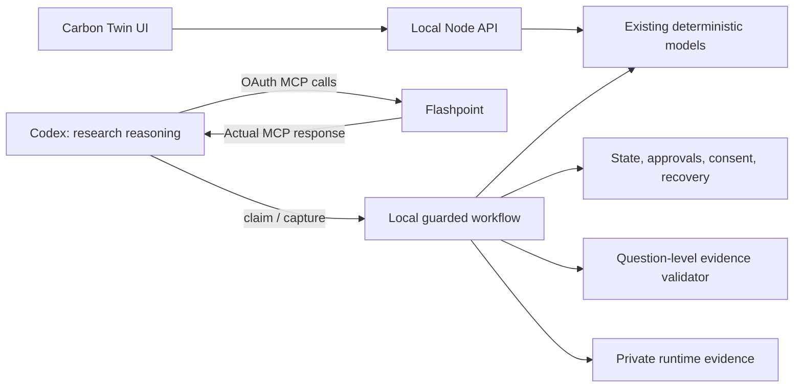

# CarbonX
### Autonomous Research for Industrial Decarbonization

**Flashpoint AI × Columbia AI Club Hackathon — Team CarbonX, November 2026**

CarbonX combines an interactive steel-plant carbon digital twin, Codex research
reasoning and real Flashpoint MCP execution. Deterministic code calculates the
illustrative scenarios and enforces state/evidence rules; Codex chooses questions,
interprets validated evidence and decides whether further research is justified.

[Technical Explainer](docs/TECHNICAL_EXPLAINER.md) ·
[Verified live evidence](challenge/REAL_FIRST_PARTY_INTEGRATION_SUMMARY.md) ·
[Live Agent runbook](docs/LIVE_AGENT_RUNBOOK.md) ·
[Submission checklist](docs/SUBMISSION.md)

**Verified result:** one real survey, one publication, one invitation, one COMPLETE
response, one retrieved/usable record and five valid answers. The participant was
the developer and some wording was assisted. This is a **REAL FIRST-PARTY SURVEY —
n=1 TECHNICAL INTEGRATION TEST**, not independent external product research.
Codex selected **STOP**. No real Round 2 was run.

## Quick start: the Carbon Twin

Prerequisites: Git, Node.js **22.19.0 or newer** with npm, and a modern WebGL browser.

```sh
git clone https://github.com/CHCYLI/CarbonX-Final-Project.git
cd CarbonX-Final-Project
npm start
```

Open **http://localhost:3000**. The main application has no external server-side
npm dependencies or build step, so root `npm install` is not required. It does not
invoke Codex, send email or call Flashpoint merely because it is started.

[Download/open the standalone HTML](CarbonX%20final%20project.html) for the offline
frontend. GitHub's HTML file viewer shows source: download the file and open it
locally. The Node backend is not hosted by GitHub Pages. The optional
[introduction video](assets/CarbonX_Intro_Video.mp4) is 3m39s; it is not a three-minute
submission demo.

## How to Run / Trigger the Autonomous Agent

**The live Agent is an interactive Codex-mediated workflow, not a separate
always-on backend.** Typing an objective into a normal shell does not launch it.
The Node CLI is a guarded local control plane; it cannot inherit Codex OAuth or
make the authenticated business call itself.

### 1. Install and authenticate

Use your own authorized Codex/Flashpoint accounts. CLI **0.171.0** was verified;
the pin below reproduces that tested client. OpenAI sign-in and Flashpoint OAuth
are separate.

```sh
npm install -g @openai/codex@0.171.0
codex --version
codex login
codex mcp list
# Only if the server is not already configured:
codex mcp add flashpoint --url https://api.flashpoint.ai/mcp
# Only if Flashpoint OAuth login is needed:
codex mcp login flashpoint
```

Complete the official browser authorization and select a team you are authorized
to use. Record that selection truthfully: this demonstration used CarbonX with
**USER_VERIFIED**, not independent API identity verification. A new user does not
inherit our team confirmation, survey IDs, recipients or approvals.

On Windows, use `codex.cmd` if PowerShell blocks the npm `codex.ps1` launcher.
Keep credentials in the client's supported credential storage, never this repo.
See the [official CLI authentication guide](https://learn.chatgpt.com/docs/auth.md).

### 2. Open this repository as Codex's working directory

```sh
cd CarbonX-Final-Project
codex
```

Or use `codex -C /path/to/CarbonX-Final-Project`, verified by the installed CLI
help. An IDE/Codex-enabled environment may open the same repository folder.

### 3. Paste this high-level instruction into Codex

> Read `AGENTS.md`, `challenge/agent.md`, `challenge/LIVE_INTEGRATION.md` and
> `docs/LIVE_AGENT_RUNBOOK.md`. Act as the CarbonX Autonomous Research Agent.
> Inspect the actual CLI/API and create a fresh private run; do not reuse the
> historical run, survey identifiers, answers or fixture decisions.
>
> **Research objective: Find the one change CarbonX should make first so a
> first-time user can understand our steel plant results and explain the
> trade-off to someone else.**
>
> Use `scripts/challenge-context.cjs` to obtain the actual illustrative model
> context. Independently choose uncertainties and research questions. Verify
> authenticated Flashpoint tool discovery and the intended account/team.
> Prepare exact requests and request explicit approval before creating a survey,
> publishing, distributing invitations or spending money. Use only consented
> private recipients. Do not generate respondents or authorize payments by default.
>
> Preserve actual survey/conversation IDs and original MCP responses. Retrieve
> actual question-level answers only when authorized, validate them through Phase
> 3 and make fresh evidence-based Codex decisions. STOP when evidence is missing
> or insufficient; propose a follow-up only when justified. Never use offline
> fixture responses or recorded decisions as live evidence.

This starts Codex's reasoning and local preparation. It is not blanket permission
for external actions and does not start a hosted LLM service. A judge can first
inspect the plan without approving any live survey or invitation.

### 4. Follow the real handoff and approval steps

Codex uses the exported workflow APIs and the existing local CLI. The
[runbook](docs/LIVE_AGENT_RUNBOOK.md) gives exact commands and private context fields.

| Step | Actual implementation |
| --- | --- |
| Context and fresh plan | `challenge-context.cjs`; workflow `initialize()`, `checkpoint('PLAN')`, `submit()` |
| Protocol-only OAuth/tool discovery | `node scripts/challenge-discover.cjs --output .runtime/challenge/my-study/discovery.json` |
| Local request and approval | CLI `request`, `approve`; exact manifest hash, scope, consent and charge ceiling |
| Durable external intent | CLI `queue`, then `claim --action ID` exactly once |
| Authenticated remote call | Codex invokes configured `mcp__flashpoint__tool_survey` using the claimed arguments |
| Actual result capture | CLI `capture` / `capture-read`, or documented API, with a reviewed hash-bound mapping |
| Full draft inspection | API `prepareInspection()` / `completeInspection()`; these are not CLI subcommands |
| Answers and research judgment | Scoped read, Phase 3 validator, fresh ANALYSIS/FOLLOWUP checkpoints |

The discovery helper uses Codex's experimental app-server metadata protocol,
tested with CLI 0.171.0. It creates no conversation/model turn/business-tool call.
Run it in the normal authenticated operator environment. A restricted agent shell
may not see the same server inventory; do not label that token expiry or fabricate
discovery proof. See the runbook for native executable override and context setup.

Human approvals cover exact operations, not arbitrary future activity. An
explicitly approved multi-operation scope can continue without duplicate approval
questions. Unexpected quota/configuration acknowledgements, charges or changed
scope must stop. Ordinary provider confirmations must remain within the actual
approved scope. Never automatically retry an uncertain resource-changing action.

### 5. Resume and retrieve

Resume the Codex session with `codex resume --last`. Separately inspect the local
run using CLI `show` and `recover`; never reinitialize over it. Claimed uncertain
actions need the same actual receipt/provider status and reconciliation, not a
second send or creation. A session resume alone does not prove remote completion.

After an authorized participant submits, continue the same survey/conversation.
Use `read-proposal`, `authorize-read`, `retrieve`, one-shot claim and actual result
capture, or the documented API for the observed provider shape. Preserve exact
response IDs privately. COMPLETE without usable answers remains
`INSUFFICIENT_EVIDENCE`. The live output shape was inspected and mapped; it is not
assumed interchangeable with browser REST credentials.

### 6. Locate artifacts

- Public: this README, [Technical Explainer](docs/TECHNICAL_EXPLAINER.md),
  [sanitized live proof](challenge/REAL_FIRST_PARTY_INTEGRATION_SUMMARY.md).
- Private new run: `run-state.json`, `events.jsonl`, hash-named `artifacts/`
  and `live-handoff/` under your chosen ignored `.runtime/challenge/...`.
- Exact original receipts, respondent IDs/answers and private lists stay private.
  State/events hold sanitized counts and evidence references.
- The offline CLI prints its run directory/report location. Its report is TEST
  DATA. Codex writes a separately sanitized report for any authorized live study.

## Offline fixture demonstration

No OAuth, wallet, LLM inference or Flashpoint call is required:

```sh
node scripts/challenge-run.cjs demo
node scripts/challenge-run.cjs demo --case empty
node scripts/challenge-run.cjs demo --case pending
```

These replay input-matched recorded Codex judgments with artificial fixtures.
The valid demo demonstrates two simulated rounds; `empty` must block on unusable
answers; `pending` stops at approval. None is a successful live Round 2.

## Architecture



Codex selects the research method, questions, interpretation and STOP/follow-up
decision. Deterministic modules handle calculations, exact approval matching,
scope, deduplication, legal stages and answer eligibility. There is no second
custom LLM backend. Model provenance distinguishes the Scenario-page model from
the separate shared API/3D engine; this integration does not reconcile their
different boundaries or alter their calculations.

## Testing

The root tests need only the supported Node runtime:

```sh
npm test
```

For all tests, restore the optional client's locked dependencies first:

```sh
npm --prefix flashpoint-client ci --ignore-scripts --no-audit --no-fund
npm run test:all
```

The verified Phase 6 total was **133 passing tests** (root 107 + client 26).
Final submission validation and audit results are recorded in
[implementation status](challenge/IMPLEMENTATION_STATUS.md) and
[security audit](docs/SECURITY_AUDIT.md). Tests use isolated mocked transport and
fixtures; they do not authenticate wallets or send real surveys/emails.

## Evidence and research integrity

| Source | What it demonstrates | Limit |
| --- | --- | --- |
| Real first-party developer test | Actual creation, publication, one invitation, COMPLETE/detail readback and five valid answers | n=1, developer familiarity, assisted wording; no independent product conclusion |
| Historical synthetic study in the app | 12 COMPLETE records, zero usable answers; analysis blocked | Exploratory AI output, not real people |
| Offline fixture demo | Deterministic guards, recovery and recorded two-round decision replay | No new LLM reasoning or remote operations |

The standalone/app Research snapshot still displays the historical synthetic
study, not the private n=1 record. No UI feature was added to substitute the data.
The real decision was STOP; Phases 7/8 were skipped by the user. No live second
survey, broader recruitment or additional invitation was executed.

Model figures are illustrative and assumption-dependent. Survey opinions do not
validate engineering, permanent CO2 storage or investment returns. No independent
API team identity or monetary billing ledger was available. Actual OAuth usage is
not a promise that future calls are free. No payment or USDC spending is authorized
by this repository's examples.

## Repository map

| Path | Purpose |
| --- | --- |
| `apps/`, `packages/` | Frontend, API and existing domain/calculation models |
| `scripts/challenge-*.cjs` | Context, local workflow, live/offline adapters, state and validation |
| `challenge/agent.md`, `AGENTS.md` | Research policy and repository instructions |
| `challenge/fixtures/` | Explicit offline TEST DATA and recorded decisions |
| `flashpoint-client/` | Separate optional wallet client, lockfile and payment/auth guards |
| `docs/` | Technical explainer, live runbook, security audit and submission checklist |
| `.runtime/` | Ignored private execution evidence; not shipped |

The legacy fixed synthetic importer remains separate. The optional wallet/x402
client is not needed for the demonstrated Codex OAuth path and grants no blanket
payment authorization. Vendored Three.js retains its license in
`apps/web/vendor/THREE_LICENSE.txt`.

## Team and submission

**Team CarbonX — Flashpoint AI × Columbia AI Club Hackathon, November 2026.**

Repository: https://github.com/CHCYLI/CarbonX-Final-Project
